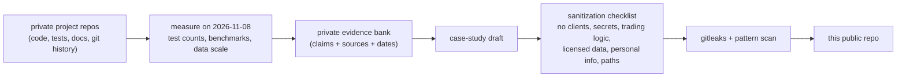

# Engineering case studies: Alex T. Rosen

I'm an Informatics graduate (Indiana University, 2025) and a cloud/data consultant. I build AI-agent systems, data
pipelines and research tooling with explicit safety and evidence rules. This repository holds sanitized write-ups
of four private projects: what each one does, how it's built, how it was tested, what went wrong, and what I
measured. It is for engineers and reviewers who want to judge the work without access to the private source.

**How I build:** these are solo projects built with AI coding agents as implementers, mainly Claude Code, with
Codex for read-only review. I set the requirements and safety rules, review and merge every change, and run the
systems. The write-ups say which decisions were mine.

## At a glance

| | |
|---|---|
| **Status** | Published. Four case studies, each a point-in-time snapshot measured on 2026-11-08. |
| **Format** | Markdown with Mermaid diagrams. No code to run. |
| **Read it** | Start with the table in [Case studies](#case-studies) below. |
| **Verified** | 2026-11-11 against `main` at `7434488`: links and diagrams checked, sanitization re-checked ([how](#testing-and-ci)) |

## Why this exists

### The problem

Most of what I build can't be public, for reasons that are real rather than cosmetic:

- The Constellation reads my own mail, calendar, notes and private AI-agent session transcripts, and uses assets
  licensed for private use.
- The Second Move uses licensed NFL competition data, and the competition rules require a private repository.
- Scalp City is trading research. Its strategy logic and simulated results stay private so they can't be read as
  investment claims.
- The ELARA Command Deck's serial protocol came from interoperability analysis of a vendor tool.

That leaves a reviewer with a gap: the engineering is real, but there is nothing to inspect.

### Why the obvious approaches fall short

| obvious approach | why it isn't enough |
|---|---|
| Make the repositories public | It would expose personal data, licensed data, trading logic or vendor internals. |
| List the projects and their stacks | Nothing to check. A list of technologies says nothing about how carefully the work was tested or what went wrong. |
| Show screenshots or a demo video | A demo shows the happy path. It hides the failures, the limits and how a result was measured. |

### Principles that follow

- **Every number is measured, dated and sourced.** Each was counted or measured from the project on 2026-11-08,
  or is labeled as coming from project docs. Lab benchmarks say they are lab benchmarks.
- **Failures and limits get their own section.** Every case study has "Failures and tradeoffs": an outage, boot
  loops, a hardware memory fault, a null research result.
- **AI authorship is stated, not hidden.** Each case study says the code is agent-written and lists the decisions
  that were mine.
- **Sanitized by rule, not by feel.** No client names or data, credentials, trading logic or parameters, licensed
  data or personal information. Diagrams are illustrative, with no hostnames, ports or paths.
- **Each one ends with questions** a reviewer can use to probe whether I understand the system.

### What it answers

Can someone judge the engineering of a private system from a short, honest write-up? The bet is that the problem,
the design choices with their reasons, the verification and the failures together say more than source code a
reviewer would not have time to read. Each case study also offers a live walkthrough of the code.

## Case studies

| case study | what it shows |
|---|---|
| [The Constellation](case-studies/the-constellation.md) | Agent observability and provenance, multi-provider LLM routing, a local voice assistant with a benchmark-driven model choice, about 4,600 unit tests |
| [ELARA Command Deck](case-studies/elara-command-deck.md) | Human-in-the-loop approval of AI-agent actions from a physical USB pad, safety-first protocol design, hardware failure recovery |
| [Scalp City](case-studies/scalp-city.md) | Tamper-evident, append-only data storage, a paper-only design enforced by tests, pre-registered evaluation, a hardware-fault incident |
| [The Second Move](case-studies/the-second-move.md) | A research pipeline over 22.7M tracking frames, synthetic-truth validation, a locked holdout, and an honestly reported null result |

## What works today

This is a documentation repository, so "works" means the content is complete, renders and holds to its rules.

| item | status | how it was verified |
|---|---|---|
| Four case studies, each with problem, role, architecture, failures, why the source is private, and questions | Complete | read on 2026-11-09; every file has those sections. Three also have "Key choices" and "Verification"; The Second Move covers them as data scale, validation, the main test and engineering |
| Mermaid diagrams (one per case study) | Working | 4 fenced `mermaid` blocks; GitHub renders them |
| Internal links (README → case studies) | Working | every relative link resolves to a file in the repo (checked 2026-11-09) |
| Sanitization: no secrets, emails, phone numbers, local paths, client names | Holds | gitleaks and a pattern scan before the first push (2026-11-08, recorded in the private audit log); pattern scan rerun for this README on 2026-11-09 |
| Numbers in the case studies | Snapshot of 2026-11-08 | measured in the private repos on that date. Not re-measured for this README, because the source is private and Scalp City is a live system |

## Quick start

There is nothing to install. Read the case studies on GitHub, where the Mermaid diagrams render. To read them
locally:

```bash
git clone https://github.com/AlexRosen23/engineering-case-studies.git
cd engineering-case-studies
ls case-studies/        # four Markdown files
```

## How it works



Each case study is written from a private evidence bank in which every claim carries its source (a command, a
file or a commit) and a date. A draft becomes public only after it passes a written sanitization checklist and an
automated scan. The source repositories stay private, and each case study says why.

They share one outline, so they can be compared side by side: problem and audience, my role, architecture
(illustrative), key choices and why, verification, failures and tradeoffs, why the source is private, and questions
I'm happy to go deeper on. The Second Move is a research project, so its middle sections follow the research instead:
data scale, validation before analysis, the main test and its null result, and engineering.

## How it was built

- **2026-11-08:** a private career-evidence audit counted and measured each project (test runs, PR counts,
  benchmarks, data scale) and recorded every figure with its source.
- **2026-11-08 (evening):** the four case studies were sanitized from that audit. Internal references, screenshot
  checklists and backlog IDs were removed. gitleaks found no leaks, and a scan for emails, phone numbers, paths and
  keys came back clean. The repository was created public on my explicit OK, with GitHub Actions disabled before
  the first push and commits under the GitHub noreply address. Single commit `5176467`.
- **2026-11-09:** this README, rewritten to the same structure as my other project READMEs
  ([PR #1](https://github.com/AlexRosen23/engineering-case-studies/pull/1)).
- **2026-11-10:** docs: link merged README PR; map hook files; hooks point to README
  ([PR #2](https://github.com/AlexRosen23/engineering-case-studies/pull/2)).

Two decisions shaped the content:

- **One repository of write-ups instead of public copies of the code.** A cleaned-up public fork would drift from
  the real system, and some of it (licensed data, the vendor protocol) can't be published at all.
- **Clients are never named.** My consulting clients stay out of public material entirely, so nothing here
  describes client work.

The drafts were written with Claude Code from the evidence bank, and I approved publishing them.

## Limitations and what's next

- **A snapshot that ages.** The numbers describe the projects on 2026-11-08. Test counts and results move as the
  projects change. One case study already notes that a newer `main` reports a different count.
- **Not independently reproducible.** Without the source, a reader has to trust the measurements. The live
  walkthrough offer is the mitigation.
- **Some figures are labeled secondhand** (taken from project docs rather than re-run), and one validation in The
  Second Move was scored by an AI reviewer. Both are labeled where they appear.
- **Next:** refresh the numbers when a project reaches a milestone, and publish The Second Move's aggregate Kaggle
  notebook before the 2027-01-06 deadline, as its case study plans.

## Repository map

| path | what it is |
|---|---|
| `case-studies/` | the four case studies (Markdown with Mermaid) |
| `README.md` | this file |
| `.githooks/` | gitleaks pre-commit and pre-push hooks (enable with `git config core.hooksPath .githooks`) |
| `.gitleaks.toml`, `.gitignore` | secret-scan settings and the ignore baseline (no `.env`, keys, databases or dependencies) |

## Testing and CI

There is no code and no test suite. For this README (2026-11-09) I checked that every relative link resolves to a
file, that each case study has the sections listed above and one Mermaid block, and that a scan for email addresses,
phone numbers, local file paths and key-like strings finds nothing.

GitHub Actions is disabled on this repository.

## Related

- Public project repositories with their own write-ups:
  [Morrowglass Model Foundry](https://github.com/AlexRosen23/morrowglass-model-foundry) ·
  [The Inkfall Vault](https://github.com/AlexRosen23/inkfall-vault) ·
  [Spectral Canary Works](https://github.com/AlexRosen23/spectral-canary-works)
- Live public project: [LAST LEGEND](https://alexrosen23.github.io/LASTLEGEND/), a browser game with GitHub Actions
  regression tests.
- No license file is included, so default copyright applies to the write-ups.
