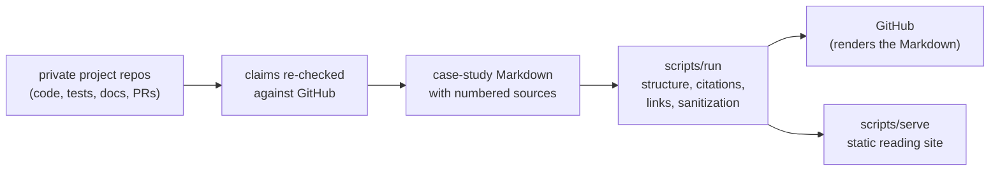

# Engineering case studies: Alex T. Rosen

**Sanitized engineering case studies**

## In plain words

**What it is:** a portfolio of six write-ups about private software projects, with a checker that stops any number from being published without a citation.

**What you get:**
- Six case studies (agent observability, a signed evidence trail, a chaos lab, a sports-analytics research pipeline, an approval pad for AI-agent actions, a paper-trading system), each following the same structure from context to "what I'd do differently".
- Numbered source notes on every figure, naming the pull request, commit or report file it came from.
- A small local reading site built from the same Markdown, plus a method page listing every claim that was corrected on re-checking.

**How it works:** the Markdown in `case-studies/` is the source of truth; `scripts/check.py` enforces structure, citations, links and sanitization, and `scripts/build_site.py` renders the static site (see [How it works](#how-it-works)).

**Try it:** read the [case studies](#case-studies) on GitHub, or run `./scripts/serve` and open http://127.0.0.1:6340/ (Python standard library only). `./scripts/run` runs the checks.

**Cited, sanitized write-ups of six private software projects, with a small local reading site and a checker that makes sure every figure is cited to its pull request, commit or report file.**

I'm an Informatics graduate (Indiana University, 2025) and a cloud/data consultant. I build AI-agent systems, data
pipelines and research tooling with explicit safety and evidence rules. This repository holds sanitized case studies
of private projects: the context, the constraints, what was built, how it was measured, what went wrong and what I
would change. It is for engineers and reviewers who want to judge the work without access to the private source.

**How I build:** these are solo projects built with AI coding agents as implementers, mainly Claude Code, with
Codex for read-only review. I set the requirements and safety rules, review and merge every change, and run the
systems. The write-ups say which decisions were mine.

## Use cases

- **Review my engineering without the source:** read a case study end to end, from context to "what I'd do differently".
- **Check a specific claim:** every number has a numbered source note naming the pull request, commit, file or test output it comes from (private sources as dated plain text; ask for a live walkthrough).
- **See what changed on re-checking:** the [method page](docs/method.md) lists every claim that was corrected or updated on 2026-11-16.
- **Prepare an interview:** each study ends with questions a reviewer can use to probe whether I understand the system.
- **Reuse the format:** the checker enforces the structure and the citation rules, so a new case study can't be published with an uncited result.

## At a glance

| | |
|---|---|
| **Status** | Published. Six case studies; evidence re-checked against GitHub on 2026-11-16. |
| **Format** | Markdown with Mermaid diagrams (renders on GitHub), plus a static reading site built from the same files. |
| **Read it** | On GitHub, start with [Case studies](#case-studies); locally, see [Run it](#run-it). |
| **Verified** | `./scripts/run` passes; `python3 scripts/check.py --online` (owner only) confirmed all 150 cited pull requests, commits and files exist on GitHub (2026-11-16). |

## Case studies

| case study | what it shows |
|---|---|
| [The Constellation](case-studies/the-constellation.md) | Agent observability with honest status, verified-by-use model routing, a benchmark-driven local model choice, and gated integration runs that ship parallel agent PRs into a live app |
| [PROVENANCE](case-studies/provenance.md) | A signed, hash-chained trail from claim to evidence to human review, with an offline verifier, test vectors, tenant isolation and a restore drill |
| [CHAOS MONKEY](case-studies/chaos-monkey.md) | A chaos lab for retries and idempotency where the main hypothesis failed, the signed evidence showed why, and the fix was reported as a comparison, not a pass |
| [The Second Move](case-studies/the-second-move.md) | A research pipeline over 22.7M tracking frames: instruments validated first, a locked holdout, and an honestly reported null result |
| [ELARA Command Deck](case-studies/elara-command-deck.md) | Human-in-the-loop approval of AI-agent actions from a USB pad, safety-first protocol design, and recovery from firmware boot loops |
| [Scalp City](case-studies/scalp-city.md) | Tamper-evident append-only storage, a paper-only design enforced by tests, pre-registered evaluation, and a hardware fault caught by hashing |

Every case study has the same sections: context, problem, constraints, my role, architecture (illustrative),
approach, evidence, results and how they were measured, trade-offs and failures, what I'd do differently, why the
source is private, questions, and sources.

## Run it

Start the reading site (Python 3.9 or newer, standard library only):

```
./scripts/serve
```

It builds the pages from the Markdown into `_site/` (git-ignored) and serves them on this machine only at
`http://127.0.0.1:6340/`: an index of the case studies, one page per study with its own table of contents and
numbered sources, and a method page. The pages are plain HTML and one stylesheet: no JavaScript, no web fonts, no
cookies, no analytics and no requests to other hosts. Stop it with Ctrl-C. Set `PORT` to use another port.

Check the write-ups and the site (sections, diagrams, links, citations, the "every result is cited" rule, the site's
links and privacy scan):

```
./scripts/run
```

Run the tests (25 tests, a few seconds):

```
python3 -m unittest discover -s tests -v
```

Optional, owner only: confirm every cited pull request, commit and file exists on GitHub. The private citations are
plain text, so this uses a local-only map (never committed) from each footnote to its real PRs, commits and files,
kept in `~/.config/engineering-case-studies/private-citations.json` or a git-ignored `data/*.local.json`. It needs an
authenticated `gh` with access to the private repositories and takes about a minute.

```
python3 scripts/check.py --online
```

## Why this exists

### The problem

Most of what I build can't be public, for reasons that are real rather than cosmetic:

- The Constellation reads my own mail, calendar, notes and private AI-agent session transcripts, and uses assets
  licensed for private use.
- The Second Move uses licensed NFL competition data, and the competition rules require a private repository.
- Scalp City is trading research. Its strategy logic and simulated results stay private so they can't be read as
  investment claims.
- The ELARA Command Deck's serial protocol came from interoperability analysis of a vendor tool.
- PROVENANCE has no license chosen yet, and CHAOS MONKEY reuses its signing code.

That leaves a reviewer with a gap: the engineering is real, but there is nothing to inspect.

### Why the obvious approaches fall short

| obvious approach | why it isn't enough |
|---|---|
| Make the repositories public | It would expose personal data, licensed data, trading logic or vendor internals. |
| List the projects and their stacks | Nothing to check. A list of technologies says nothing about how carefully the work was tested or what went wrong. |
| Show screenshots or a demo video | A demo shows the happy path. It hides the failures, the limits and how a result was measured. |

### Principles that follow

- **Every number is cited.** A figure appears only with a note naming the pull request, commit, file or test output
  it comes from. Private sources are cited as dated plain text, never as links, hashes or paths. The few that exist only in the 2026-11-08 private audit (a test run on a copy, row counts over
  licensed data) say so.
- **Failures and limits get their own section,** and so does "what I'd do differently".
- **Re-checks are published.** Claims that did not hold up are corrected in place and listed on the method page.
- **AI authorship is stated, not hidden.** Each case study says the code is agent-written and lists the decisions
  that were mine.
- **Sanitized by rule, not by feel.** No client names or data, credentials, trading logic or parameters, licensed
  data or personal information. Diagrams are illustrative, with no hostnames, ports or paths.

## What works today

| item | status | how it was verified |
|---|---|---|
| Six case studies with the 13 required sections and a diagram | Complete | `./scripts/run` (structure check) |
| 102 numbered sources (97 private-repository citations as plain text, 5 from the private audit); every Results line with a number is cited | Complete | `./scripts/run` (citation checks) |
| No link, slug, commit hash or file path points into a private repository | Holds | `./scripts/run` (private-exposure rule, Markdown and built site) |
| Cited pull requests, commits and files exist | Confirmed 2026-11-16 | `python3 scripts/check.py --online` with the local map: 150 distinct, 0 missing |
| Reading site: index, six study pages, method page | Working | `./scripts/serve`; links, anchors and privacy scan checked by `./scripts/run`; checked by eye at desktop and phone width |
| Sanitization: no secrets, emails, phone numbers, local paths, client names | Holds | pattern scan in `./scripts/run`; gitleaks hooks on every commit and push |

## How it works



- `case-studies/*.md` are the source of truth. GitHub renders them as they are.
- `scripts/build_site.py` renders the same files into plain HTML: footnotes become a numbered source list with
  back-links, flowcharts become SVG with a text version, and sequence diagrams become a numbered list of messages.
- `scripts/check.py` enforces the rules above and builds the site into a temporary folder to check it.
- `data/repos.json` lists the public repositories a link may point to; anything else counts as private.

## How it was built

- **2026-11-08:** a private career-evidence audit counted and measured each project and recorded every figure with
  its source. The first four case studies were sanitized from it and published on my explicit OK (commit `5176467`).
- **2026-11-09 to 11-11:** README write-up and hook documentation
  ([PR #1](https://github.com/AlexRosen23/engineering-case-studies/pull/1),
  [#2](https://github.com/AlexRosen23/engineering-case-studies/pull/2),
  [#3](https://github.com/AlexRosen23/engineering-case-studies/pull/3)).
- **2026-11-16:** FEATURES.md ([PR #4](https://github.com/AlexRosen23/engineering-case-studies/pull/4)) and the first
  checker ([PR #5](https://github.com/AlexRosen23/engineering-case-studies/pull/5)). Then, on my request to "go a
  little bit deeper", every claim was re-checked against GitHub, the four studies were rewritten to the 13-section
  structure with numbered sources, PROVENANCE and CHAOS MONKEY were added, and the reading site and citation checks
  were built ([PR #6](https://github.com/AlexRosen23/engineering-case-studies/pull/6)).

The drafts are written with Claude Code from the repositories and the evidence audit, and I approve publishing them.

## Limitations and what's next

- **Private sources.** A citation into a private repository proves nothing to someone who cannot open it. The live
  walkthrough offer is the mitigation.
- **Snapshots age.** Each study says when its evidence was checked. Test counts and results move as projects change.
- **Some figures are labeled secondhand:** a few come only from the 2026-11-08 private audit, and one validation in
  The Second Move was scored by an AI reviewer. Both are labeled where they appear.
- **The site is local.** It is built for reading and for screenshots; it is not deployed anywhere.
- **Next:** publish The Second Move's aggregate Kaggle notebook before the 2027-01-06 deadline, and re-run
  `--online` whenever a study changes.

## Repository map

| path | what it is |
|---|---|
| `case-studies/` | the six case studies (Markdown with Mermaid and numbered sources) |
| `docs/method.md` | how claims are checked, and the 2026-11-16 corrections |
| `data/repos.json` | the public repositories a link may point to |
| `scripts/serve` | builds and serves the reading site on loopback |
| `scripts/build_site.py`, `scripts/site.css` | the static site builder and its stylesheet |
| `scripts/run`, `scripts/check.py` | the checker (`--online` confirms citations on GitHub) |
| `tests/` | tests for the checker, the site builder and the serve script |
| `.githooks/` | gitleaks pre-commit and pre-push hooks (enable with `git config core.hooksPath .githooks`) |
| `.gitleaks.toml`, `.gitignore` | secret-scan settings and the ignore baseline (no `.env`, keys, databases, dependencies or `_site/`) |

## Testing and CI

`python3 -m unittest discover -s tests -v` runs 25 tests: the checker against throwaway fixture repositories (each
rule fires when it should and stays quiet when it shouldn't), the site builder (landmarks,
source lists, diagrams, no scripts), the real repository passing the checker, and the serve script answering on a
loopback port. GitHub Actions is disabled on this repository; everything runs locally.

## Related

- Public project repositories with their own write-ups:
  [Morrowglass Model Foundry](https://github.com/AlexRosen23/morrowglass-model-foundry) ·
  [The Inkfall Vault](https://github.com/AlexRosen23/inkfall-vault) ·
  [Spectral Canary Works](https://github.com/AlexRosen23/spectral-canary-works)
- Live public project: [LAST LEGEND](https://alexrosen23.github.io/LASTLEGEND/), a browser game with GitHub Actions
  regression tests.
- No license file is included, so default copyright applies to the write-ups.
