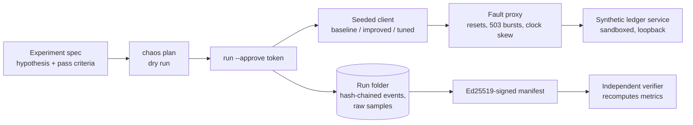

<!-- meta: {"nav": "CHAOS MONKEY", "order": 3, "snapshot": "2026-11-16", "summary": "A local chaos lab for retry and idempotency behaviour, where the main hypothesis failed and the signed evidence showed why.", "tags": ["fault injection", "retries and idempotency", "signed evidence", "failed hypothesis"]} -->
# CHAOS MONKEY: a retry experiment that failed, and what the evidence showed

> Sanitized case study of a private repository. Everything ran on one machine against a synthetic service, so these are lab results, not production results. Built with AI coding agents: Claude Code implemented it, an independent agent reviewed the safety design, and I set the scope and rules and approved the merges.

## Context

CHAOS MONKEY is a small chaos lab for one question that real payment and ledger APIs care about: when the network misbehaves, do retries with idempotency keys keep every transfer applied exactly once without hurting availability? The design follows published practice: AWS Builders' Library guidance on retries, Stripe-style idempotency keys, the IETF Idempotency-Key draft and gRPC's retry design (A6)[^matrix].

It was built on 2026-11-15 and 16. The lab, the evidence engine and the results landed in one pull request[^pr3]; an evidence API and a small showcase UI followed[^later].

## Problem

Retry advice is easy to state and hard to check. A retry policy that looks safe in a code review can still apply a transfer twice (a retry arrives after the server committed but before the client heard back) or can quietly refuse retries the client needed. I wanted each experiment to state a falsifiable hypothesis before it ran, measure it under injected faults, and leave evidence that anyone could re-verify without trusting the lab code.

## Constraints

- **One machine, no root.** Faults had to be userspace: a proxy that resets connections, a simulated full disk and a per-process clock offset. Kernel packet loss and filling a real disk were ruled out because they need root or change machine-wide state[^decisions].
- **Contained.** Loopback only, a deny-by-default macOS sandbox around the target, and a single-use approval token for every run; `chaos plan` is the dry run[^decisions].
- **Shared load.** Runs were sequential at low priority with caps on concurrency and duration, so other work on the machine kept going[^decisions].
- **Zero runtime dependencies.** TypeScript on Node, reusing PROVENANCE's signing code with a separate key purpose[^decisions].

## My role

- Set the scope (retries and idempotency, sourced from published guidance) and the rules: dry run first, approval per run, results reported as observed.
- Approved the merges. The code, the experiment specs and the analysis are agent-written; an independent agent's safety review produced fixes before merge[^pr3].

## Architecture (illustrative)

## Approach

- **Write the hypothesis first.** Each experiment in the matrix states its fault, its load and its pass criteria. E4: "30% of connections reset after commit for 4 s… nothing twice, nothing lost, availability ≥95%, recovery within 2 s"[^matrix].
- **Compare conditions on the same seeds.** `baseline` is a naive client, `improved` is the subject (idempotency keys plus a gRPC-A6-style retry throttle), and later `tuned` and `guarded` were added as comparison conditions only. The verdict is always about the subject as written[^decisions].
- **Load and repeats.** Open-loop at 40 intents per second for 12 seconds, about 480 intents per run, five seeded repeats per condition, reported as medians with 95% bootstrap intervals[^results].
- **Signed evidence.** Every run writes a hash-chained event log and raw samples, sealed by an Ed25519-signed manifest that digests every file. A verifier that imports nothing from the lab re-hashes the files, checks the chain and signature against a pinned public key, and recomputes the metrics from the raw samples[^trust].

## Evidence

- The experiment matrix with the hypotheses as written[^matrix].
- The results narrative and the per-condition tables[^results][^tables].
- The decision record, including the rule that pass criteria stay "exactly as written"[^decisions].
- The pinned verification key and the verifier[^trust].

## Results and how they were measured

| Experiment / condition | Duplicates | Availability | Notes |
|---|---|---|---|
| E4 `baseline` | 68 [54, 83][^tables] | 99.8%[^tables] | applies transfers twice |
| E4 `improved` (the subject) | 0[^tables] | 90.8% [89.0, 92.9][^tables] | **hypothesis failed in 5 of 5 seeds** (91.7, 92.9, 90.8, 90.2 and 89.0%) |
| E4 `tuned` | 0[^tables] | 99.8% [99.2, 100][^tables] | throttle charged only for 429/503 |
| E7 `improved` | 0 in 5 of 5 seeds[^results] | n/a | a "confounded pass": the throttle refused every retry, so expired keys were never exercised |
| E7 `tuned` | 0 [0, 2]; 2 of 5 seeds had duplicates, 3 transfers in total[^results] | n/a | wall-clock key expiry plus a 90 s clock jump |
| E7 `guarded` | 0 in 5 of 5 seeds[^results] | 99.6%[^results] | key age on a monotonic clock |
| Evidence verification | 125 of 125 runs verified[^results] | n/a | `npm run verify -- --pin` with the committed key, 2026-11-16 |

Why E4 failed: in the attempt logs, 217 of 218 failed `improved` intents ended on a refusal by the client's own retry throttle, and only one ran out of attempts[^results]. The throttle follows gRPC A6 (10 tokens, ratio 0.1), which charges a token for every failure, including the harmless resets the experiment injected, so it sheds load at roughly a 9% failure rate. The idempotency keys worked; the throttle refused retries the client needed.

## Trade-offs and failures

- **The subject failed, and the verdict stands.** `tuned` was added after the failure was seen, so it is reported as a comparison, never as a pass for E4[^decisions].
- **`tuned` is not a free fix.** Under a real 503 burst (E2) and E6, `tuned` behaves like `improved` at 81.0% and 83.5% availability; a separate storage-failure signal such as 507 is "not built or measured"[^results].
- **E7 needed a second look.** The subject's clean result came from refusing retries, not from handling expiry. The duplicate in `tuned` was traced in the sealed samples: the retry arrived after the clock jump, the 60 s key looked stale, and the service answered with a fresh 201 instead of a replay[^results].
- **Lab limits.** One shared machine (load average 7.9 to 26.0 across runs), userspace faults only, a deprecated macOS sandbox, scaled-down key retention to fit 12-second runs, and wide intervals from five repeats. Re-runs will not be byte-identical[^results][^decisions].
- **A macOS gotcha.** Liveness checks by process group return a permission error for a group whose only member is a zombie, so run supervision reads process state instead.

## What I'd do differently

- **Re-run on Linux or a VM with kernel-level fault injection**, which the decisions name as the next step[^decisions].
- **Test a distinct storage-failure signal (507) end to end**, the gap the results name[^results].
- **Make `guarded` survive a restart**: a clock jump across a restart is not covered[^results].
- **Pre-commit hypotheses separately.** The specs and the `tuned` client landed in the same commit, so git alone cannot prove the hypothesis predates the first run; the record rests on the decision log[^decisions][^phases].

## Why the source is private

The lab reuses PROVENANCE's signing code, which has no license yet, so making the repository public is an open decision recorded in the decision log[^decisions]. The method, numbers and failure analysis are all here, and the signed evidence can be verified live.

## Questions I'm happy to go deeper on

1. Why does a token-bucket retry throttle that is right for overload hurt you on transient resets?
2. What does an idempotency key's retention window have to do with clocks, and why a monotonic clock?
3. What does the signed manifest prove, and what can it not prove?

## Sources

Numbered notes tie each claim to the pull request, commit, file or test output it comes from. The sources live in private repositories, so they are cited as plain text (project, PR number, date, kind of document) with no links, hashes or paths; each was confirmed to exist on 2026-11-16, and I'm happy to open any of them in a live walkthrough.

[^matrix]: Private repository (CHAOS MONKEY): experiment matrix with the hypotheses and fault specs as written, as of 2026-11-16.
[^pr3]: Private repository (CHAOS MONKEY): the prototype, chaos lab, evidence engine and results, PR #3 (2026-11-16), including a commit of fixes from the independent safety review.
[^later]: Private repository (CHAOS MONKEY): evidence API, PR #4 (2026-11-16), and showcase UI, PR #7 (2026-11-16).
[^decisions]: Private repository (CHAOS MONKEY): decision log as of 2026-11-16 (D1 stack, D2 sandbox, D3 no root, D9 load limits, D10 conditions and unchanged pass criteria, D11 open questions).
[^results]: Private repository (CHAOS MONKEY): results write-up as of 2026-11-16 (method, attempt-log analysis, E7 trace, limits, verification).
[^tables]: Private repository (CHAOS MONKEY): results tables as of 2026-11-16 (E4 seeds 1400–1404).
[^trust]: Private repository (CHAOS MONKEY): the pinned public key and the independent verifier source, as of 2026-11-16.
[^phases]: Private repository (CHAOS MONKEY): the specs and the `tuned` client landed in one commit, and the `guarded` expiry in a later commit, both 2026-11-16.
