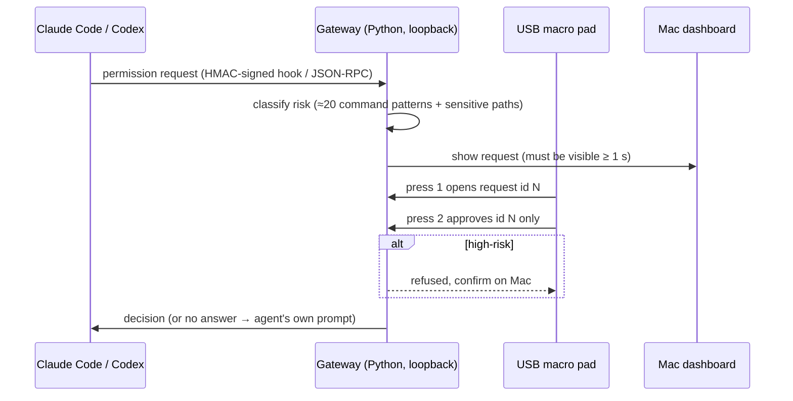

# ELARA Command Deck: approving AI-agent actions from a physical pad

> Sanitized case study. The repositories are private. Vendor protocol internals are deliberately omitted. Diagrams are illustrative. Built with AI coding agents: Claude Code implemented it, and I directed, tested on hardware, recovered the device and approved changes.

## Problem and audience
AI coding agents ask permission constantly. Clicking "approve" in a terminal breaks flow, but a single hardware approve button would make blind approvals easy. Goal: fast approvals that still require you to look, with dangerous actions kept off the pad entirely. The audience is any developer running Claude Code or Codex with approvals on.

## My role
- Product owner and hardware operator: I bought and handled the pad, ran on-device tests and found the real 2×6 layout.
- After 3 boot loops I recovered the device myself.
- I set the safety rules and approved every merge. Code is AI-written.

## Architecture (illustrative)

A separate Swift library, CLI and menu-bar app configure the pad over USB serial, with hash-verified backup and restore.

## Key choices and why
- **Two presses bound to one request id:** no "approve all" and no session-wide grants.
- **Fail closed:** if the gateway doesn't answer, the agent shows its normal prompt.
- **Credential split:** the token that can approve exists only in gateway memory. Files on disk can't approve, so a file-reading agent can't approve itself. This came from an independent review.
- **Refuse risky pad writes:** no direct configs on dial slots 13–18 after the boot loops.

## Verification
- 205 gateway tests pass (pytest, run 2026-11-08). The newer main reports 230.
- 194 Swift tests in 22 suites pass (run 2026-11-08).
- Both suites use fakes or pseudo-terminal serial ports, so they don't prove hardware behaviour. Hardware behaviour was checked on the device (key tester plus gateway log).

## Failures and tradeoffs
- **3 boot loops (Nov 2, 2026):** each followed a direct config on one dial slot. Recovery: factory reset, sector repair, official firmware reflash. The fix is a code guard. Root cause: correlation, not proof.
- **Missing key:** the firmware never sends F13. Found by black-box testing and remapped.
- **Wrong layout assumption:** the code assumed a 4×3 grid; the pad is 2×6. Refactored with a pinned mapping test.
- **Not done:** microphone and voice capture on the device, and knob-chord navigation.

## Why the source is private
The pad's serial protocol was worked out through interoperability analysis of a vendor tool, so I keep those details private. The approval design, failures and tests are all here, and I'm happy to walk through the code live.

## Questions I'm happy to go deeper on
1. What happens if two requests arrive between press 1 and press 2?
2. Why HMAC on localhost?
3. How did you decide the boot-loop guard was the right call without a proven root cause?
