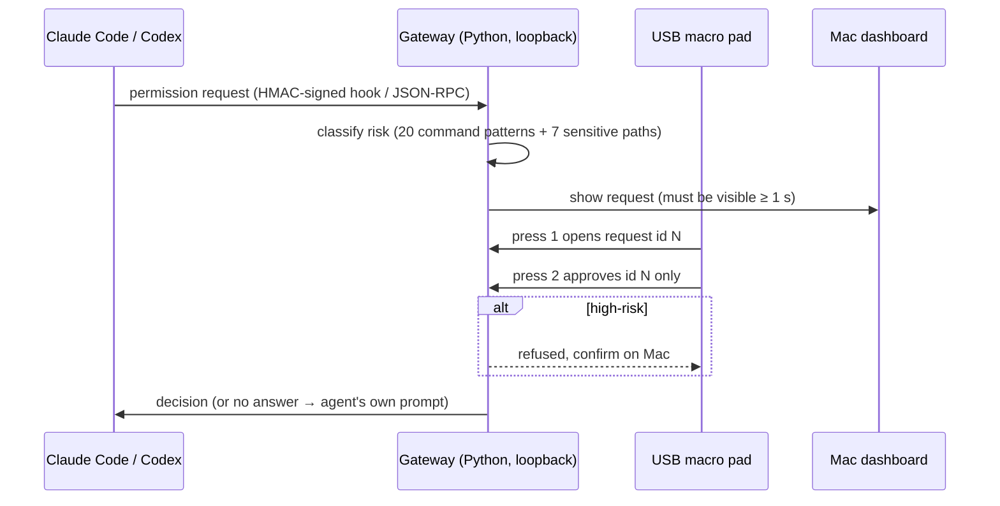

<!-- meta: {"nav": "ELARA Command Deck", "order": 5, "snapshot": "2026-11-16", "summary": "Approving AI-agent actions from a physical USB pad without making blind approvals easy, and recovering the pad from three firmware boot loops.", "tags": ["human-in-the-loop", "safety-first design", "hardware integration", "incident recovery"]} -->
# ELARA Command Deck: approving AI-agent actions from a physical pad

> Sanitized case study. The repositories are private, and vendor protocol internals are deliberately omitted. Diagrams are illustrative. Figures were re-checked against GitHub on 2026-11-16; corrections are marked. On 2026-11-16 the dashboard was renamed ORION; the repository keeps the old name[^rename]. Built with AI coding agents: Claude Code implemented it, and I directed, tested on hardware, handled the device and approved changes.

## Context

AI coding agents ask permission constantly: to run a command, edit a file, push a branch. The Command Deck routes those requests from Claude Code and Codex to a local gateway and lets me answer them from a 12-key, two-dial USB macro pad, with a dashboard on the Mac showing exactly what is being approved. It is two repositories: a Python gateway with a dashboard (first release merged 2026-10-26[^v1]) and a Swift library, CLI and menu-bar app that configure the pad over USB serial[^padkit].

## Problem

Clicking "approve" in a terminal breaks flow, but a single hardware approve button makes blind approval easy: one press, whatever has focus, done. The goal was fast approvals that still require looking at the request, with dangerous actions kept off the pad entirely.

## Constraints

- **The pad can only send keystrokes.** It has no way to receive a request or show which one it is approving[^readme].
- **No published protocol.** The vendor's configurator is Windows-only, so programming the pad from a Mac meant working out the serial protocol through interoperability analysis, with every fact tagged as verified on the device or not[^protocol].
- **Fragile firmware.** Some configuration writes crash the pad on boot, as the boot loops below showed[^hwlog].
- **macOS service rules.** The background service cannot read the Desktop folder, so the gateway runs behind a Node wrapper[^launchd].

## My role

- Product owner and hardware operator: I handled the pad, ran the on-device tests and told the build session the real key layout.
- I set the safety rules (no approve-all, high-risk only on the Mac, no direct dial configurations after the boot loops) and approved every merge.
- The code is agent-written.

## Architecture (illustrative)

## Approach

- **Two presses bound to one request id.** The first press opens a specific request; the second approves only that id, and only after the dashboard has shown it for at least one second. There is no "approve all" and no session-wide grant[^approvals].
- **Classify risk and keep high-risk off the pad.** 20 command patterns (recursive deletes, `sudo`, force pushes, publishing, credential stores and others) plus 7 sensitive-path rules mark a request high-risk; those need a confirmation on the Mac[^approvals].
- **Fail closed.** If the gateway does not answer, the agent shows its normal permission prompt. "Silence never approves"[^readme][^split].
- **Split the credentials.** The token that can approve lives only in the gateway's memory and is handed to the dashboard once. Files on disk hold a hook-signing key and a CLI token that cannot decide, so an agent that reads files cannot approve itself. This came from an independent review of the approval path[^split].
- **Chords instead of a custom device protocol.** The pad sends key chords that the gateway catches as global hotkeys, which need no Accessibility permission. The cost is that the pad gets nothing back[^readme].
- **Pad writes live outside the always-on gateway.** All configuration goes through the Swift tool, with hash-verified backup and restore before writes, whole operations serialized so multi-frame writes never interleave, and partial restores flagged[^backup].

## Evidence

- Gateway tests (pytest) with fakes for the pad, apps and Codex; Swift tests with pseudo-terminal serial ports and fake ports[^tests230][^swift].
- A hardware log of each boot loop, its trigger and its recovery[^hwlog].
- A pinned mapping test that captured every slot, input, action and chord from `main` before the layout refactor[^layout].

## Results and how they were measured

| Result | Value | How it was measured |
|---|---|---|
| Gateway tests | 230 passed on `main` after the layout PR (205 in the earlier audit run, before it)[^tests230][^audit] | pytest; the suite uses fakes, so it does not prove hardware behaviour |
| Swift tests | 238 tests in 26 suites (194 PadKit + 44 CLI)[^swift] | `swift test`; *corrected*: the earlier write-up said 194 in 22 suites, which is the library target only |
| Risk rules | 20 command patterns and 7 sensitive-path rules[^approvals] | read from the classifier |
| Review delay | at least 1.0 s on screen before press 2 counts[^approvals] | `MIN_REVIEW_S` |
| Layout refactor | an empty diff of every chord and key field against the table captured from `main` before the change[^layout] | pinned mapping test; nothing was sent to the pad |
| Latency and reliability | not measured[^readme] | the README says so |

Hardware behaviour (key presses, the missing F13 key, the layout) was checked on the device with a browser key tester and the gateway log, not by the test suites[^f13].

## Trade-offs and failures

- **Three boot loops on 2026-11-02.** All three followed a direct configuration of one dial slot (slot 16); the first was a media-key configuration. Recovery for the first two is recorded (a factory reset, then upgrade mode with a sector repair and the vendor's official firmware); recovery from the third is not recorded in the repository[^hwlog]. The fix is a code guard: the Swift library refuses direct consumer-key configurations and any direct configuration of dial slots 13–18, and dials use the script route only[^guards]. The cause is "not proven": the guard rests on a correlation. *Corrected on 2026-11-16:* the earlier write-up said I recovered the device after all three loops; the repository records two recoveries.
- **A missing key.** The firmware never sends F13, which two pad keys were mapped to. Found by black-box testing and remapped to other chords[^f13].
- **A wrong layout assumption.** The code assumed 3 rows of 4 keys; the pad is 2 rows of 6 plus two stacked dials (18 slots). *Corrected:* the earlier write-up said 4×3. Refactored behind the pinned mapping test[^layout].
- **Two presses versus one.** I asked for one-press approval including high-risk requests; it is not built and "needs an explicit decision", because it removes the look-before-approve step[^readme].
- **Not done:** microphone capture on the device (transcription works, the microphone is not bought), knob-chord agent navigation (the bottom dial sends plain arrows), Codex CLI approvals on the pad, and redeploying the live service, which still ran the pre-layout build on 2026-11-10[^readme].

## What I'd do differently

- **Measure it.** The README admits there are no latency or reliability numbers; press-to-decision latency is the number that matters for flow[^readme].
- **Write the hardware log as it happens.** The third recovery was never written down[^hwlog].
- **Keep the live service on `main`.** The dashboard fix shipped to `main` but not to the running service[^readme].

## Why the source is private

The pad's serial protocol was worked out through interoperability analysis of a vendor tool, so I keep those details private. The approval design, failures and tests are all here, and I'm happy to walk through the code live.

## Questions I'm happy to go deeper on

1. What happens if two requests arrive between press 1 and press 2?
2. Why HMAC on localhost?
3. How did you decide the boot-loop guard was the right call without a proven root cause?

## Sources

Numbered notes tie each claim to the pull request, commit, file or test output it comes from. The sources live in private repositories, so they are cited as plain text (project, PR number, date, kind of document) with no links, hashes or paths; each was confirmed to exist on 2026-11-16, and I'm happy to open any of them in a live walkthrough.

[^rename]: Private repository (ELARA Command Deck): ORION rebrand of the UI and docs, PR #12 (2026-11-16).
[^v1]: Private repository (ELARA Command Deck): v1.0 gateway, PR #1 (2026-10-26).
[^padkit]: Private repository (pad configuration tool): library, CLI and preset, PR #1 (2026-11-03), and menu-bar app with dial safety, PR #2 (2026-11-03).
[^readme]: Private repository (ELARA Command Deck): README as of 2026-11-16 ("Why the obvious approach falls short", "Key decisions", "Known gaps", "Results").
[^protocol]: Private repository (pad configuration tool): protocol notes as of 2026-11-16, each fact tagged verified-on-device, from analysis, or uncertain.
[^hwlog]: Private repository (pad configuration tool): hardware log as of 2026-11-16 (the three loops, recovery, rules).
[^launchd]: Private repository (ELARA Command Deck): Node wrapper for the background service, PR #6 (2026-11-04).
[^approvals]: Private repository (ELARA Command Deck): approval-classifier source as of 2026-11-16 (the minimum review time, the high-risk command patterns, the sensitive paths and the Mac-only confirmation).
[^split]: Private repository (ELARA Command Deck): a commit of 2026-10-26 titled "address independent review of the approval path", in PR #1 (2026-10-26). The reviewer is not named and no review file is committed.
[^backup]: Private repository (pad configuration tool): four commits of 2026-11-02 (hash-verified backup and restore, serialized operations, and the partial-restore flag).
[^tests230]: Private repository (ELARA Command Deck): PR #8 (2026-11-04) body ("230 passed (25 new)"), re-run in PR #11 (2026-11-10).
[^audit]: Private evidence audit, 2026-11-08: pytest on a copy of the gateway before the layout PR → 205 passed. Not in git.
[^swift]: Private repository (pad configuration tool): PR #6 (2026-11-10) body (238 tests in 26 suites); an earlier commit of 2026-11-04 reported only the library's 194.
[^layout]: Private repository (ELARA Command Deck): 2×6 layout and the pinned mapping test, PR #8 (2026-11-04).
[^f13]: Private repositories: the F13 finding in an ELARA Command Deck commit of 2026-11-02, merged in PR #2 (2026-11-02), and the matching change in the pad configuration tool the same day.
[^guards]: Private repository (pad configuration tool): four commits on 2026-11-02 and early 2026-11-03 UTC: two refusing direct consumer-key configurations, one refusing direct configurations of dial slots 13–18, and one documenting the rules.
