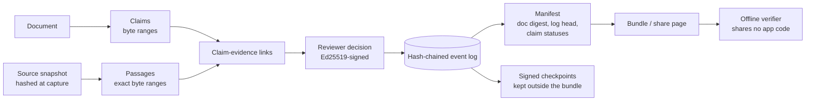

<!-- meta: {"nav": "PROVENANCE", "order": 2, "snapshot": "2026-11-16", "summary": "A signed, hash-chained trail from claim to evidence to human review for AI-assisted documents, with an offline verifier that trusts none of the app's code.", "tags": ["signatures and hash chains", "human review", "verification", "multi-tenant API"]} -->
# PROVENANCE: a signed trail from claim to evidence to human review

> Sanitized case study of a private repository. All data in it is synthetic. Built with AI coding agents: Claude Code implemented it, and I set the rules (statuses only from signed human review, verbatim citations only), reviewed and approved the merges.

## Context

AI-assisted memos and reports mix claims a person checked with claims a model wrote. PROVENANCE records, for one document, which passage of which source supports each claim, who reviewed it and what they decided, as a chain of signed events that can be verified offline. It was built from 2026-11-15, in twelve merged pull requests: a verification slice first, then an integrity layer, a workspace UI, share pages, a REST API, an SDK, tenant isolation and operations[^prs].

## Problem

A tracked-changes history or a comment thread says who typed what, not whether a claim was checked against a source, and it can be edited later. An "AI detector" says nothing about truth. The question a reviewer needs answered is narrower and checkable: for each claim, is there an exact passage from a captured source, did a named reviewer sign a decision about it, and has anything changed since?

## Constraints

- **Integrity, not truth.** "Signatures prove integrity and recorded approvals, not truth"[^readme]. The design must not let a model, or a claim's own author, mark a claim as supported.
- **Verbatim only.** A citation is an exact byte range of a captured snapshot, and a claim is a byte range of the document, so a paraphrase cannot pass as a quote[^spec].
- **Verifiable without the app.** A third party must be able to check a bundle with a verifier that shares no code with the workspace[^spec].
- **Small and local.** Node 24 with zero runtime dependencies, a strict canonical-JSON subset, no network or hosted infrastructure[^readme].

## My role

- Set the rules that define the product: model output never sets a status, citations are verbatim byte ranges, fixtures stay synthetic.
- Reviewed and approved the merges. The code is agent-written.

## Architecture (illustrative)

## Approach

- **Statuses only from signed review.** Claims start `unreviewed`. Only a reviewer who is not the claim's author can sign `supported`, `disputed` or `unverifiable`; `supported` needs a linked passage, the others need a rationale. Model confidence is stored but never read[^readme].
- **Re-derive, don't trust, the manifest.** The verifier rebuilds the manifest from the reviewer-signed events and requires byte equality, so a key that can issue bundles still cannot change review outcomes[^readme].
- **Detect history rewrites.** The manifest commits to the log head and length, so truncation shows. Signed checkpoints kept outside the bundle make a rewritten history visible as a fork, even to someone holding every key[^readme].
- **Spec plus test vectors.** A written verification spec and a vector file (canonical JSON, SHA-256, document digests, commitments, signatures and the RFC 8032 known-answer test) let a second implementation check itself[^spec][^vectors].
- **Separate verdicts.** The verifier reports integrity, attestations, evidence, sources and disclosure separately, lists what it did not check, and uses stable exit codes (0 verified, 1 integrity or signer failure, 2 usage, 3 other checks failed)[^spec].
- **Treat sources as data.** Text inside a source that looks like instructions changes no status and is flagged for the reviewer[^adversarial].

## Evidence

- Adversarial tests: a non-verbatim citation signed by a trusted editor, a real quote on the wrong byte range and a swapped snapshot are all rejected; key rotation, compromised keys and exit codes are tested[^adversarial].
- A route × scope × tenant matrix: another tenant's project always returns 404 or 403 with no leaked data, plus path-trick containment and a hash-chained audit log per tenant[^isolation].
- A restore drill on 2026-11-16[^drill].
- Test totals recorded in each pull request body[^p9][^p11].

## Results and how they were measured

| Result | Value | How it was measured |
|---|---|---|
| Test suite growth | 43 → 57 → 62 → 68 → 76 → 81 → 82 → 92 → 112 passing across PRs #1–#11[^p1][^p9][^p11] | `npm run check`, as recorded in each PR body |
| Latest recorded run | 112 of 112 in 15 files, on the adapter branch, not on `main`[^p11] | PR body and the feature list |
| Adversarial tests | 8 cases[^adversarial] | test file count |
| Tenant isolation | 6 matrix tests, all cross-tenant reads 404 or 403[^isolation] | test file |
| Restore drill | 9 of 9 checks passed: 17 files (63,515 bytes) backed up with 6 key and token files excluded; both restored projects verify (21 and 18 events); 8 claims matched; one flipped bit detected; a tampered backup refused before any write[^drill] | scripted drill, recorded in the repo |
| Drill timings | backup 10 ms, restore 6 ms, re-verify 9 ms[^drill] | same drill, demo-sized data |

## Trade-offs and failures

- **Demo keys on one server.** Four persona keys live on one machine for the demo; a real deployment needs a key per reviewer (WebAuthn or a KMS)[^threat].
- **Self-asserted time.** Timestamps are the signer's own claim, so someone holding a superseded key could backdate; RFC 3161 timestamps or a transparency log are planned[^threat].
- **Anchoring is only as good as its storage.** A checkpoint kept next to the data protects little[^threat].
- **Exact quotes can still mislead.** Verbatim citations stop paraphrase, not cherry-picking; that is what the human reviewer is for[^threat].
- **Revoking a share stops the page, not the copy.** A downloaded bundle verifies until it expires[^threat].
- **Unvalidated product.** No discovery interviews or external security review yet; the security review in the repo is a self-review[^threat].

## What I'd do differently

- **A second verifier in another language** to flush out spec ambiguities, which the threat model names[^threat].
- **Per-reviewer hardware-backed keys and external timestamps** before any pilot[^threat].
- **Interviews before features.** The pricing and the buyer are hypotheses until someone uses it[^threat].

## Why the source is private

It is an unreleased product idea with no license chosen yet. The design, tests and drill results are all here, and I'm happy to walk through the verifier and the spec live.

## Questions I'm happy to go deeper on

1. Why can an issuer key not change a review outcome in this design?
2. What does a signed checkpoint outside the bundle add over the hash chain?
3. Where would you put the trust boundary in a real deployment with many reviewers?

## Sources

Numbered notes tie each claim to the pull request, commit, file or test output it comes from. The sources live in private repositories, so they are cited as plain text (project, PR number, date, kind of document) with no links, hashes or paths; each was confirmed to exist on 2026-11-16, and I'm happy to open any of them in a live walkthrough.

[^prs]: Private repository (PROVENANCE): merged pull requests PR #1 (verification slice) through PR #12 (README use cases), including PR #5 (REST API) and PR #6 (SDK), all merged 2026-11-16 (UTC).
[^readme]: Private repository (PROVENANCE): README as of 2026-11-16.
[^spec]: Private repository (PROVENANCE): verification spec (draft v1) as of 2026-11-16.
[^vectors]: Private repository (PROVENANCE): test-vector file as of 2026-11-16, from PR #2 (2026-11-16).
[^adversarial]: Private repository (PROVENANCE): adversarial test file as of 2026-11-16, from PR #2 (2026-11-16).
[^isolation]: Private repository (PROVENANCE): tenant-isolation test file as of 2026-11-16, from PR #8 (2026-11-16).
[^drill]: Private repository (PROVENANCE): restore-drill record of 2026-11-16, from PR #9 (2026-11-16).
[^p1]: Private repository (PROVENANCE): PR #1 (2026-11-16) body: 43 passing.
[^p9]: Private repository (PROVENANCE): PR #9 (2026-11-16) body: 92 passing.
[^p11]: Private repository (PROVENANCE): PR #11 (2026-11-16) body: 112 passing; feature list as of 2026-11-16.
[^threat]: Private repository (PROVENANCE): threat model and section 8 of the feature list, as of 2026-11-16; product hypotheses in the product brief of the same date.
