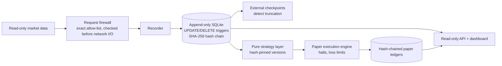

# Scalp City: an auditable, paper-only market research platform

> Sanitized case study. The repo is private. **No strategies, parameters, prices, P&L or account details appear here, and none should be inferred.** This is a simulation platform: it has never placed a real order and contains no code that could. Built with AI coding agents: Claude Code implemented it, and I set constraints, made the recorded owner decisions and operate it.

## Problem and audience
Trading research is easy to fool yourself with: overfitting, quietly edited history, and accidental live orders. I wanted a platform where every result could be audited and no bug could ever touch real money. The audience is me as researcher, and anyone interested in tamper-evident data systems.

## My role
- Set the non-negotiables: paper only, read-only market data, isolated credentials.
- Made the recorded owner decisions: hosting pause after the hardware fault, the archive size cap, experiment approvals.
- Approved merges and operate the services.

## Architecture (illustrative)

## Key choices and why
- **Paper-only by construction:** no order code exists. Static AST tests fail if anyone adds it, the firewall denies account and order paths, and the live mode always refuses to start.
- **Tamper evidence:** every row joins a hash chain in the same transaction. Checkpoints stored outside the database catch tail truncation, which a self-consistent chain can't. Startup verification refuses to append on failure.
- **Reproducibility:** batch replay and the live observer must produce identical decision digests, and strategy code is pinned by hash.
- **Pre-registration:** the selection protocol was committed before strategies were frozen or evaluated. **No candidate passed, so none was selected.**

## Verification
- 499 pytest test functions in 56 files: static boundary tests, firewall denial tests, and review-regression tests written to fail on the pre-fix commit.
- Not re-run during this audit because the system is live. A Phase 0–3 report records 333/333 offline tests passing.
- CI runs security scans. Tests run locally (no CI test gate).

## Failures and tradeoffs
- **Hardware memory fault (Oct 7–9, 2026):** segfaults and two database corruptions. Hashing the same bytes 4 times gave 3 different SHA-256 values. I preserved evidence before any repair, logged each step before taking it, paused hosting and moved to new hardware with host fencing.
- **Disk growth (8–10 GB per session):** chose nightly verified rotation plus a size cap, accepting the permanent loss of the oldest raw quotes. Every deletion is logged.
- **Limits:** no property-based tests, no CI test gate, single host.

## Why the source is private
It's trading research. Strategy logic and simulated results stay private so they can't be read as investment claims. The integrity design, incident handling and test approach are all here, and I'm happy to walk through the code live.

## Questions I'm happy to go deeper on
1. Why can't a hash chain alone detect truncation?
2. What can a hash chain *not* protect against? (A bit flip before hashing.)
3. How does pre-registration change what you can claim from a backtest?
