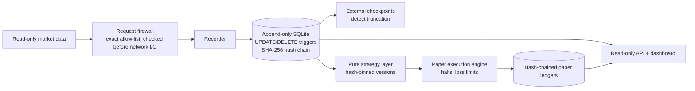

<!-- meta: {"nav": "Scalp City", "order": 6, "snapshot": "2026-11-16", "summary": "A paper-only market research platform built so every result can be audited: append-only hash-chained storage, no order code, pre-registered evaluation, and a hardware fault caught by hashing.", "tags": ["tamper-evident storage", "safety by construction", "pre-registration", "incident response"]} -->
# Scalp City: an auditable, paper-only market research platform

> Sanitized case study. The repo is private. **No strategies, parameters, prices, P&L or account details appear here, and none should be inferred.** This is a simulation platform: it has never placed a real order and contains no code that could. Figures were re-checked against GitHub on 2026-11-16; corrections are marked. Built with AI coding agents: Claude Code implemented it, and I set constraints, made the recorded owner decisions and operate it.

## Context

Scalp City records read-only market data, replays it through hash-pinned strategy code, and simulates fills in paper ledgers. It started on 2026-10-05 with phases 0–3 (feed, recorder, dashboard)[^phase03] and runs continuously as a set of local services. It is the system I trust least to be right by default, so most of its engineering is about making mistakes visible.

## Problem

Trading research is easy to fool yourself with: overfitting, quietly edited history, and accidental live orders. I wanted a platform where every result could be audited after the fact and no bug could ever touch real money.

## Constraints

- **Paper only, by construction.** Read-only market data, isolated credentials, and no order code at all.
- **Rows cannot be deleted.** Every table rejects updates and deletes, so storage only grows: about 8 to 10 GB per session before the 2026-11-15 storage change[^ops].
- **Fragile hardware at the start.** The first machine had 8 GB of RAM, and macOS `fsync` does not flush the drive cache, which mattered once databases began to corrupt[^inc7].
- **One writer.** A copied or restored data folder must never append to a chain on another machine.

## My role

- Set the non-negotiables: paper only, read-only market data, isolated credentials.
- Made the recorded owner decisions: pausing hosting after the hardware fault, the archive size cap, the storage change, experiment approvals[^inc9][^cap][^dbv2].
- Approve merges and operate the services. The code is agent-written.

## Architecture (illustrative)

## Approach

- **Paper-only by construction.** No order code exists. The live mode is declared only so it can be displayed and tested, and resolving it always raises an error[^modes]. Static AST tests fail if anyone adds order code, a random number generator or a network import to the simulator[^static], and the firewall denies account and order paths before any network I/O[^firewall].
- **Tamper evidence.** Every row joins a SHA-256 hash chain in the same transaction. "A hash chain cannot detect its own tail being cut off", so checkpoints stored outside the database record the last sequence and hash; startup verification refuses to append if either check fails[^arch].
- **Reproducibility.** Batch replay and the live observer must produce the same decision digest for any partition of the rows, and strategy code is pinned by hash[^arch].
- **Pre-registration.** The selection protocol was committed at 17:01 on 2026-10-05, before the strategy specs were frozen at 17:07 and before any evaluation[^prereg]. A later shadow-only research layer committed its own lock file before any strategy touched recorded data[^edge].
- **Host fencing.** Each chain is bound to one machine, one process runs per role, and a new epoch starts in fresh checkpoint folders; a restored copy refuses to write elsewhere[^epoch2].

## Evidence

- The incident reports for 2026-10-07, 10-08 and 10-09, written step by step with each corrective step "appended below with its time, before it is taken"[^inc7][^inc8][^inc9].
- Review-regression tests for the host-fencing work, each written to fail on the pre-fix commit[^epoch2].
- The phase 0–3 report, including eight defects found in live verification, such as a false integrity alarm caused by reading chain and row counts in separate snapshots, fixed with one read transaction and a regression test[^phase03].

## Results and how they were measured

| Result | Value | How it was measured |
|---|---|---|
| Test functions (snapshot) | 499 in 56 files at 2026-11-07[^audit] | count of `def test_` in a clone |
| Test functions (now) | 587 in 65 files[^tests-now] | same count on the 2026-11-16 main branch |
| Recent full runs | 900 passed; then 920 passed, 1 failed, 3 deselected, where the failure was a timeout under heavy load that passed on rerun[^runs][^dbv2] | pytest, as recorded in the PR bodies (parametrized cases included) |
| Phase 0–3 offline suite | 333 of 333 on 2026-10-05[^phase03] | recorded in the phase report |
| Hardware fault evidence | the same first 1 GiB of a preserved file, hashed four times, gave three different SHA-256 values; a gzip CRC check also failed[^inc8] | repeated reads during the incident |
| Storage change | a measured session went from 9.35 GB to about 6 GB, with hash values, links and checkpoints unchanged[^dbv2] | page statistics on a sealed archive whose hash matched its manifest |
| Strategy selection | no candidate passed the pre-registered gates, so none was selected[^phase4] | the selection protocol |

## Trade-offs and failures

- **The hardware fault (2026-10-07 to 10-09).** Three abrupt shutdowns in three days, segfaults inside the Python runtime, seven engine restarts in a crash loop on 10-09, and **three** database corruptions (*corrected:* the earlier write-up said two)[^inc9]. The repeated-hash test pointed to "faulty memory (or the storage path)"; a hardware diagnostic is listed as the next step with no result recorded, so "memory fault" is the likely cause, not a proven one[^inc8]. I had evidence preserved before any repair, paused hosting, and moved the system to a different machine with host fencing[^inc9][^epoch2].
- **What a hash chain cannot do.** A bit flipped before hashing is recorded consistently, so the chain proves the data was not changed after it was written, not that it was right when written[^inc8].
- **Disk growth and the size cap.** Nightly verified rotation plus a size cap, accepting the permanent loss of the oldest raw quotes, which cannot be fetched again; every deletion is logged in a manifest[^cap]. The later storage change took one of three offered options; the option of streaming fewer contracts was not approved, so busy days still reach about 9.2 GB[^dbv2].
- **Single host by design.** Fencing is a binding file per machine, not a shared lease, and the docs say so[^ops].
- **Limits:** no property-based tests and no CI test gate; CI runs security scans only[^ci].

## What I'd do differently

- **Segment full verification.** Verifying the whole chain takes about 150 seconds per trading day and grows; the architecture doc names per-day segmentation as the fix[^arch].
- **Add a CI test gate and property-based tests** for the chain and ledger invariants; both are named limits today[^ci].
- **Keep the design trail in the repo.** The host-fencing design was reconstructed from a patch, and three of its commits carry an agent identity with no co-author trailer, so git cannot show who designed what[^epoch2].

## Why the source is private

It's trading research. Strategy logic and simulated results stay private so they can't be read as investment claims. The integrity design, incident handling and test approach are all here, and I'm happy to walk through the code live.

## Questions I'm happy to go deeper on

1. Why can't a hash chain alone detect truncation?
2. What can a hash chain *not* protect against? (A bit flip before hashing.)
3. How does pre-registration change what you can claim from a backtest?

## Sources

Numbered notes tie each claim to the pull request, commit, file or test output it comes from. The sources live in private repositories, so they are cited as plain text (project, PR number, date, kind of document) with no links, hashes or paths; each was confirmed to exist on 2026-11-16, and I'm happy to open any of them in a live walkthrough.

[^phase03]: Private repository (Scalp City): phase 0–3 report, last changed by a commit of 2026-10-05.
[^ops]: Private repository (Scalp City): operations document as of 2026-11-16 (session sizes, rotation and cap, fencing limits).
[^inc7]: Private repository (Scalp City): incident report of 2026-10-07.
[^inc8]: Private repository (Scalp City): incident report of 2026-10-08 ("Hardware evidence", "Implications").
[^inc9]: Private repository (Scalp City): incident report of 2026-10-09, with PR #4 and PR #5 (both 2026-10-09).
[^cap]: Private repository (Scalp City): rotation and size cap, "the owner's decision", with what the owner accepts, PR #14 (2026-10-26).
[^dbv2]: Private repository (Scalp City): storage format 2, approved by the owner, with measured sizes and test results in the body, PR #36 (2026-11-15).
[^modes]: Private repository (Scalp City): execution-mode source as of 2026-11-16.
[^static]: Private repository (Scalp City): static boundary tests as of 2026-11-16.
[^firewall]: Private repository (Scalp City): firewall tests and the architecture document, as of 2026-11-16.
[^arch]: Private repository (Scalp City): architecture document as of 2026-11-16 (chain, checkpoints, startup verification, replay digest, verification time).
[^prereg]: Private repository (Scalp City): commit order on 2026-10-05: the selection protocol at 17:01, the strategy freeze at 17:07 (local time).
[^edge]: Private repository (Scalp City): a shadow-only research layer, PR #29 (2026-11-09), whose lock file was committed before any strategy touched recorded data.
[^epoch2]: Private repository (Scalp City): host fencing, PR #10, PR #11 and PR #12 (all 2026-10-21); review-fix commits of 2026-10-12; the design reconstructed from a patch in a commit of 2026-10-11.
[^audit]: Private evidence audit, 2026-11-08: count of test functions in a clone of the 2026-11-07 main branch. Not in git.
[^tests-now]: Private repository (Scalp City): count of test functions in the test folder on the 2026-11-16 main branch.
[^runs]: Private repository (Scalp City): PR #34 (2026-11-10) body: 900 passed.
[^phase4]: Private repository (Scalp City): phase 4 research report as of 2026-11-16 ("none is selected, and none is forced").
[^ci]: Private repository (Scalp City): security workflow, PR #24 (2026-11-03); no workflow runs the tests.
