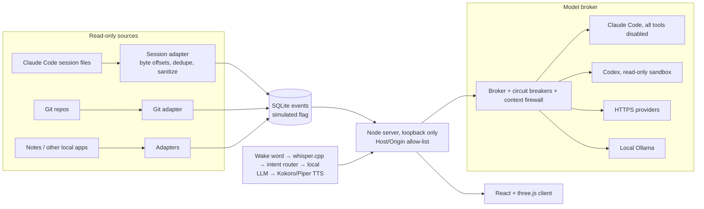

# The Constellation: a local-first command center for AI coding agents

> Sanitized case study. The source is private (it integrates personal data). Diagrams are illustrative. Numbers were verified on 2026-11-08 unless labeled. Built with AI coding agents: Claude Code implemented it, and I directed, reviewed, approved and operated it.

## Problem and audience
When several AI coding agents work across dozens of repositories, one person loses track of what actually happened: which agent is working, which finished, what's stale and what's simulated. The Constellation is my personal operations console. The audience is me, plus anyone curious how to make agent work observable without trusting it blindly.

## My role
- Product owner and technical director.
- I wrote the specs and safety fences (trading projects excluded, read-only adapters, approval per autonomous run), chose between options, reviewed and approved 339 merged PRs (Oct 18 – Nov 8, 2026), and ran the live service.
- About 94% of non-merge commits carry a Claude co-author trailer.

## Architecture (illustrative)

## Key choices and why
- **Local-first and loopback-only:** the data includes private transcripts and notes. Cost: no public demo.
- **Honest status over guessed status:** progress without a denominator reads "unmeasured", ETAs appear only with at least 3 comparable attempts, and simulated events carry a flag.
- **Verify models by use:** a model is "available" only after a completed request, not because it appears in a catalog.
- **Benchmark-driven model choice** (below).

## Verification
- About 4,600 Vitest cases (421 files) and 525 Playwright tests (131 specs), including 21 safety-lab suites (prompt injection, context firewall, credentials, spending, host/origin).
- A re-run of 296 safety and compute tests passed on 2026-11-08. A full run recorded in project docs: 3,641/3,641 (2026-11-01).
- CI runs weekly gitleaks and trivy scans with checksum-pinned tools. Tests run locally before merge, **not in CI** (a known gap).

## Measured results (lab, Apple M5 Pro, 48 GB)
| Model (Ollama) | Answered | First-word p50 / p95 | Quality (rubric) | Memory |
|---|---|---|---|---|
| llama3.2:3b | 36/40 | 90 / 238 ms | 4.0 | 2.9 GB |
| gpt-oss:20b | 39/40 | 732 / 2,370 ms | 4.43 | 12 GB |
| **qwen3.6:35b (chosen)** | **40/40** | **236 / 1,355 ms** | **4.7** | 27.9 GB |

Quality was scored by a rubric and has not been human-graded yet. TTS: Kokoro first audio p50 is 180–304 ms, and Piper vs macOS `say` is 28 vs 903 ms.

## Failures and tradeoffs
- **5-minute outage (Oct 30, 2026):** a committed `node_modules` symlink replaced the live folder's real one on fast-forward. Fixed the same day, with a guard script and a pre-merge diff check.
- **Held back Vite 8:** it would add an MPL-2.0 dependency outside the licence allow-list.
- **Limits:** no CI test gate, no containers, and the code is largely agent-written. Some feature docs lag the code.

## Why the source is private
The Constellation reads my personal data (mail, calendar, notes) and private AI-agent session transcripts, and uses third-party assets licensed for private use only. The architecture, test approach and measurements are all here, and I'm happy to walk through the code live.

## Questions I'm happy to go deeper on
1. How do you ingest a file that's still being written without double-counting after a restart?
2. What does the context firewall block, and how did you test it?
3. Which agent-written change did you reject or rework, and why?
