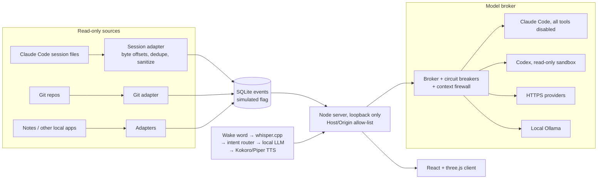

<!-- meta: {"nav": "The Constellation", "order": 1, "snapshot": "2026-11-16", "summary": "Observing many AI coding agents without trusting them blindly, and getting their parallel pull requests into a live local app through gated integration runs.", "tags": ["agent observability", "LLM routing", "test gates", "release engineering"]} -->
# The Constellation: a local-first command center for AI coding agents

> Sanitized case study. The source is private because it integrates personal data. Diagrams are illustrative. Figures first measured on 2026-11-08 were re-checked against GitHub on 2026-11-16, and the ones that did not hold up are corrected below and listed in the [method page](../docs/method.md). Built with AI coding agents: Claude Code implemented it, and I directed, reviewed, approved and operated it.

## Context

The Constellation is my personal operations console for AI coding agents. It started on 2026-10-18[^first]. By 2026-11-08 it had 339 merged pull requests, and by 2026-11-16 it had 524[^prs]. It runs as a long-lived local service on one machine and reads, read-only, the session files of Claude Code, the git repositories the agents work in, and a few local apps.

Most of the work arrives as many small, parallel pull requests opened by agent sessions. That shapes the whole system: the console has to show what the agents actually did, and the release process has to absorb a steady stream of agent-written changes without breaking the running app.

## Problem

When several AI coding agents work across dozens of repositories, one person loses track of what actually happened: which agent is working, which finished, what is stale and what is simulated. A dashboard that guesses (a progress bar with no denominator, an ETA from one sample, a model listed as "available" because it appears in a catalog) is worse than none, because it looks authoritative.

The second problem appeared later. Once ten agent PRs a day land on the same app, each passing its own tests, the combination can still fail, and the app is live. I needed a way to merge them together, prove the combination, and update the running service with a way back.

## Constraints

- **Personal data.** The console reads private agent transcripts, notes and calendar data, so it binds to loopback only and accepts only loopback Host and Origin headers[^host]. There is no public demo.
- **Agent-written code.** About 94% of non-merge commits carry a Claude co-author trailer[^authorship]. Trust has to come from tests, logs and review, not from authorship.
- **One machine, shared.** The app, other services and several agent sessions share one computer. About 136 end-to-end specs are wired to one test port, so only one end-to-end run can happen at a time, and seven simultaneous unit-test runs overloaded the machine on 2026-11-15[^e2e-lock][^slot].
- **No CI test gate.** GitHub Actions runs security scans only. Every test runs locally before a merge[^ci].

## My role

- Product owner and technical director. I wrote the specs and safety fences (trading projects excluded, read-only adapters, approval per autonomous run), chose between options, reviewed and approved the merges, and ran the live service.
- I made the recorded release decisions, such as keeping Vite 7 when the upgrade broke the license policy[^vite].
- The code, tests and tooling are agent-written[^authorship].

## Architecture (illustrative)

How changes reach the live app:

```mermaid
flowchart LR
  PRs[Agent PRs, each green alone] --> INT[One integration branch<br/>from main]
  INT --> G1[npm ci, typecheck,<br/>world check]
  G1 --> G2[Full unit suite<br/>2 machine-wide slots]
  G2 --> G3[Production build]
  G3 --> G4[Full end-to-end suite<br/>machine-wide lock,<br/>one rerun of failures]
  G4 --> M[Merge on GREEN]
  M --> B[Verified backup]
  B --> FF[Fast-forward live folder,<br/>build, restart]
  FF --> H[Health + served commit<br/>+ live spec]
  H --> RB[Rollback section<br/>written in the log]
```

## Approach

### Honest status over guessed status

- Progress without a denominator reads "Progress unmeasured"[^unmeasured].
- An ETA appears only with at least 3 comparable past attempts; otherwise the UI says "ETA unavailable — insufficient history"[^eta].
- Events produced in fixture mode carry a `simulated` flag[^simulated].
- The session adapter tails transcript files with stored byte offsets, so a restart neither loses nor double-counts events, and keeps only tool names, project-relative paths and timestamps, not content.

### Verify models by use

The broker treats a model as available only after a completed request: "a model appearing in a catalog is not access"[^broker]. The Claude Code provider runs with every tool disabled, so it can answer but never act; Codex runs in a read-only sandbox.

### Benchmark-driven model choice

The local voice assistant needed a brain that answers fast enough to feel like conversation. Three local models were run on the same 20 prompts, twice, with first-word latency, a rubric quality score and memory recorded in a committed JSON file[^bench]. The larger model was chosen because it answered every prompt with the best rubric score at a first-word p50 under a quarter of a second.

### Getting parallel agent PRs into the live app

- **Integrate together.** A scripted skill merges a list of PRs onto one `chore/integrate-<date><letter>` branch from `main`, resolves the known shared-file conflicts (documentation tables by union, generated manifests by regenerating), and runs the gates in order: clean install, typecheck, world check, full unit suite, production build, full end-to-end suite. It prints GREEN or RED with counts[^integrate].
- **Share the machine fairly.** Full unit runs take one of two machine-wide slots[^slot], and the end-to-end suite takes a machine-wide lock with one automatic rerun of failures[^e2e-lock].
- **Update the live app with a way back.** The live-update skill checks first (clean `main`, fast-forward possible, disk space, lock state) and changes nothing until `--apply`. Then: a backup that must print `BACKUP VERIFIED`, a fast-forward, clean install, a production build that must name the new commit, a service restart, a health check with fresh uptime, a log line naming the served commit, and the four-test live spec under the lock. A rollback section is written into the log right after the backup[^live].
- **Check each PR before it is merged.** A `verify-pr` command builds the PR head in a throwaway worktree, runs that repo's own gates, scans the range with gitleaks, and flags hygiene problems such as a committed `node_modules` or symlink. It prints READY or NOT READY and never merges[^verifypr].

## Evidence

- **Tests:** a Vitest unit suite and a Playwright end-to-end suite in the repo, plus safety-lab suites for prompt injection, the context firewall, credentials, spending and Host/Origin checks[^tests][^safety].
- **Benchmarks:** committed JSON files with the raw voice and model measurements[^bench][^voice][^tts].
- **Release runs:** each integration is a pull request whose body records the gate counts[^run15a][^run16f][^run14d][^run16b].
- **Decisions:** a decision log and acceptance doc that separate measured results from fixtures and owner checks, with the rule "A passing fixture test never counts as live"[^acceptance].

## Results and how they were measured

| Result | Value | How it was measured |
|---|---|---|
| Unit tests (snapshot) | about 4,600 cases in 421 files[^tests] | grep of `it(`/`test(` calls at the 2026-11-08 snapshot; `.each` tables add more |
| End-to-end tests (snapshot) | 525 top-level `test(` cases in 131 specs[^tests] | grep at the same snapshot |
| Safety-lab suites | 20 test files (the docs said 21)[^safety] | file count at the snapshot (corrected) |
| Safety and compute re-run | 296 of 296 passed in 22 files, 2026-11-08[^audit] | targeted Vitest run, hermetic |
| Full unit run, 2026-11-01 | 3,641 of 3,641, on a fix branch, not on `main`[^state] | recorded in the project's state doc |
| Local brain choice | 40 of 40 answered, first word p50 236 ms, p95 1,355 ms, rubric 4.7, 27.9 GB[^bench] | 2 runs × 20 prompts, Apple M5 Pro, 48 GB; the rubric was scored by the agent, not human-graded |
| Alternatives | gpt-oss:20b 39 of 40, p50 732 ms, rubric 4.43; llama3.2:3b 36 of 40, p50 90 ms, rubric 4.0[^bench] | same run |
| Speech output | Kokoro first audio p50 180.5 / 262.5 / 304.4 ms for 2 / 16 / 34 words[^voice] | 10 runs per length |
| Piper vs macOS `say` | 28 vs 903 ms first audio on a 2-word line; 121 vs 938 ms on a sentence[^tts] | 20 runs |
| Integration 2026-11-15a | 9 PRs; 6,474 unit passed, 1 skipped; end-to-end 655 passed, 2 failed then passed on rerun → GREEN[^run15a] | gate chain above |
| Integration 2026-11-16f | 5 PRs; 6,603 unit passed, 1 skipped; end-to-end 4 failed first, all passed on rerun → GREEN[^run16f] | gate chain above |
| Scripted integrations | 10 integration PRs from 2026-11-14 to 11-16 covering about 45 member PRs[^integrations] | tally of the integration PR bodies |

## Trade-offs and failures

- **A 5-minute outage (2026-10-30).** A merged PR accidentally tracked a worktree's `node_modules` symlink, because the ignore rule `node_modules/` matches folders only. Fast-forwarding the live folder replaced its real `node_modules`, and the app was down from 14:57 to 15:02. The fix, merged the same day, untracked the symlink and changed the rule to `node_modules`[^outage]. *Corrected on 2026-11-16:* an earlier version said a guard script was added then. The script it named is older and checks something else. The later guard is `verify-pr`'s hygiene check, which flags a committed `node_modules` or symlink[^verifypr].
- **Held back Vite 8.** The grouped dependency upgrade passed typecheck, build and 3,937 of 3,938 unit tests. The one failure was the license guard: Vite 8 pulls in lightningcss (MPL-2.0), outside the allow-list of the in-app template builder. I closed it and stayed on Vite 7[^vite].
- **A RED run that was the environment.** The first unit run of integration 2026-11-15a had 30 failures in sandbox tests. A disk clean-up had emptied the npm cache, so offline installs failed. Re-warming the cache fixed it with no code change[^run15a].
- **One stalled spec can fail ten.** In one integration, a guided-tour spec stalled under load and never ended its tour, so nine other specs got the wrong answers. Each passed alone. The follow-up makes every test end a tour it leaves running[^cascade].
- **GREEN tolerates known flakes.** A failure that passes on its rerun counts as load, and a short, named list of repeat flakes is accepted. That keeps the pipeline moving on a shared machine, at the cost of trusting a hand-maintained list[^integrate].
- **Rollback is a written procedure, not automatic.** Restoring data needs my OK[^live].
- **Limits:** no CI test gate, no containers, and the code is largely agent-written.

## What I'd do differently

- **Put the unit suite in CI.** Everything runs locally today[^ci], which is why runs compete for one machine.
- **Free the end-to-end suite from one port.** The lock exists because about 136 specs share it[^e2e-lock]; parallel suites would cut the 1–2 hour gate.
- **Tighten local API auth first.** Guarding the session and private read endpoints is recorded as "proposed, not done; required before any network-reachable guest feature"[^decisions].
- **Generate the feature numbers.** The feature list had drifted (it said 293 PRs, 115 specs and 21 safety suites). The fix split the list into parts that are updated in every PR[^features].

## Why the source is private

The Constellation reads my personal data (mail, calendar, notes) and private AI-agent session transcripts, and uses third-party assets licensed for private use only. The architecture, test approach and measurements are all here, and I'm happy to walk through the code live.

## Questions I'm happy to go deeper on

1. How do you ingest a file that's still being written without double-counting after a restart?
2. What does the context firewall block, and how did you test it?
3. When an integration run is RED, how do you tell a real regression from load, and when would you stop trusting the flake list?
4. Which agent-written change did you reject or rework, and why?

## Sources

Numbered notes tie each claim to the pull request, commit, file or test output it comes from. The sources live in private repositories, so they are cited as plain text (project, PR number, date, kind of document) with no links, hashes or paths; each was confirmed to exist on 2026-11-16, and I'm happy to open any of them in a live walkthrough.

[^first]: Private repository (The Constellation): first merged pull request, PR #1 (2026-10-18).
[^prs]: Private repository (The Constellation): merged-PR counts from the GitHub PR list: 339 on 2026-11-08 (private evidence audit, 2026-11-08) and 524 on 2026-11-16, the latest being integration PR #537 (2026-11-16).
[^host]: Private repository (The Constellation): server source as of 2026-11-08 (the Host/Origin allow-list), covered by the safety-lab Host/Origin suite.
[^authorship]: Private repository (The Constellation): 1,064 of 1,136 non-merge commits carry a Claude co-author trailer, counted at the 2026-11-08 snapshot.
[^e2e-lock]: Private repository (release tooling): the end-to-end skill and its port lock, PR #13 (2026-11-14); skill instructions as of 2026-11-16.
[^slot]: Private repositories: the two-slot limit on full unit runs, added after seven simultaneous runs overloaded the machine, release tooling PR #20 (2026-11-15) and The Constellation PR #515 (2026-11-16).
[^ci]: Private repository (The Constellation): the only workflow is a security scan (gitleaks 8.30.1 and trivy 0.76.1 with checksum-verified downloads, actions pinned by SHA, weekly and on PRs), PR #251 (2026-11-03).
[^vite]: Private repository (The Constellation): grouped major upgrade closed on the owner's decision, with the license-guard failure in the review, PR #254 (2026-11-03).
[^unmeasured]: Private repository (The Constellation): adapter source as of 2026-11-08 (the "Progress unmeasured" label).
[^eta]: Private repository (The Constellation): forecast source as of 2026-11-08 (a minimum of 3 samples), from PR #1 (2026-10-18).
[^simulated]: Private repository (The Constellation): server source as of 2026-11-08 (events carry `simulated` in fixture mode).
[^broker]: Private repository (The Constellation): model-broker source as of 2026-11-08, introduced in PR #21 (2026-10-19).
[^bench]: Private repository (The Constellation): committed model benchmark (run 2026-11-02, file as of 2026-11-07), added in PR #234 (2026-11-02). The benchmark files moved in the later ORION rename.
[^voice]: Private repository (The Constellation): committed voice benchmark (file as of 2026-11-07), PR #234 (2026-11-02).
[^tts]: Private repository (The Constellation): committed speech benchmark (run 2026-10-31), PR #222 (2026-10-31).
[^tests]: Private repository (The Constellation): test folders at the 2026-11-08 snapshot; counting commands in the private evidence audit, 2026-11-08.
[^safety]: Private repository (The Constellation): the safety-lab test folder at the 2026-11-08 snapshot holds 20 test files and 4 fixtures; the feature list of the same date said 21.
[^audit]: Private evidence audit, 2026-11-08: a targeted Vitest run of the safety-lab, model-safety and compute tests → 22 files, 296 passed. Not in git.
[^state]: Private repository (The Constellation): project state document as of 2026-11-08 (320 files, 3,641 of 3,641, "On main itself not re-run"), added in PR #131 (2026-10-26).
[^integrate]: Private repository (release tooling): the integration skill, gate order and flake rules, PR #13 (2026-11-14), with later fixes in PR #21 (2026-11-16) and PR #24 (2026-11-16); skill instructions as of 2026-11-16.
[^live]: Private repository (release tooling): the live-update skill, PR #13 (2026-11-14); skill instructions as of 2026-11-16.
[^verifypr]: Private repository (release tooling): verify-pr, with the `node_modules` and symlink hygiene check and its test, PR #15 (2026-11-14).
[^run15a]: Private repository (The Constellation): PR #518 (2026-11-16) (integration 2026-11-15a: 9 PRs, counts and the npm-cache cause in the body).
[^run16f]: Private repository (The Constellation): PR #537 (2026-11-16) (integration 2026-11-16f: 5 PRs).
[^run14d]: Private repository (The Constellation): PR #502 (2026-11-15) (integration 2026-11-14d: 10 PRs).
[^run16b]: Private repository (The Constellation): PR #524 (2026-11-16) (integration 2026-11-16b).
[^integrations]: Private repository (The Constellation): scripted integration PRs #499, #502 (both 2026-11-15), #518, #519, #520, #522, #524, #527, #535 and #537 (all 2026-11-16); member counts tallied from their bodies.
[^acceptance]: Private repository (The Constellation): acceptance document as of 2026-11-08 (evidence classes measured, fixture, owner, not run), PR #314 (2026-11-06).
[^outage]: Private repository (The Constellation): cause, PR #211 (2026-10-30); fix, PR #212 (2026-10-30), whose body records the outage window.
[^cascade]: Private repository (The Constellation): the stalled tour in integration PR #499 (2026-11-15), fixed by a commit of 2026-11-15 in PR #502 (2026-11-15).
[^decisions]: Private repository (The Constellation): decision 8 in the decision log as of 2026-11-08, PR #314 (2026-11-06).
[^features]: Private repository (The Constellation): feature list split into per-PR parts, PR #512 (2026-11-16), then caught up in PR #521 (2026-11-16).
