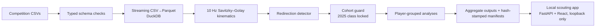

<!-- meta: {"nav": "The Second Move", "order": 4, "snapshot": "2026-11-16", "summary": "A sports-tracking research pipeline over 22.7 million frames that validated its instruments first, locked a holdout, and reported a null result.", "tags": ["research pipeline", "validation", "leakage control", "null result"]} -->
# The Second Move: NFL tracking research that reported a null result

> Sanitized case study. The repo must stay private under competition rules, and the data is licensed (CC BY-NC 4.0). Aggregates only; no player names. Figures were re-checked against GitHub on 2026-11-16; corrections are marked. Built with AI agents: I prompted and edited the research brief with ChatGPT, Claude Code implemented, and Codex reviewed read-only. I set direction and scope, chose the exploratory write-up and approved merges. Research status: **exploratory; the confirmatory test was not run; nothing submitted yet** (deadline 2027-01-06[^deadline]).

## Context

The NFL Big Data Bowl 2027 provides player-tracking data from games and from the Combine (the pre-draft athletic testing event). The project asked whether tracking reveals athletic traits, such as change-of-direction ability and tracked sprint speed, that predict on-field outcomes beyond the official Combine numbers. Alongside the research it built a local scouting app (FastAPI and React) that serves only aggregate views[^plan].

## Problem

Sports analytics makes it easy to find something: thousands of derived features, a few hundred players, and outcomes measured with noise. The risk is not a bug but a false finding. The project needed instruments that were validated before they were used, a holdout that the analysis could not peek at, and rules for what counts as an effect, fixed before any model was fitted.

## Constraints

- **Licensed data, private repository.** The competition rules require a private repository and allow public sharing only through Kaggle; derived per-player files stay out of git[^compliance].
- **Small samples.** 510 prospects in total, of whom 497 appear in game tracking; the main test had 42 eligible receivers and tight ends[^compliance][^speedsep].
- **A late lock.** The 2025 draft class was locked as a holdout after setup and the first pipeline had already touched some of its rows; the exposure is disclosed in a ledger rather than hidden[^ledger].

## My role

- Set direction and scope: Kaggle data only, aggregate-only public output, a local FastAPI plus React tool.
- Set the review exit rule (a final blocking-only review round).
- When the results came back null, chose to publish them honestly as exploratory[^plan].

## Architecture (illustrative)

## Approach

- **Validate the instruments first.** The redirection detector was tested on synthetic trajectories with known cuts, compared with the vendor's own kinematics, and audited blind on real sequences; sprint-speed reliability was measured within position[^detector][^checks][^audit][^reliability].
- **Lock the holdout in code.** A development cohort object serves only 2023–24 draft-class rows and raises an error for 2025 ids; a static test fails if an entry point opens a player file without the guard[^ledger].
- **Fix the rules before fitting.** A 5% minimum effect, train-only preprocessing, and a decision to stop promotion if the effect did not hold in both directions[^speedsep].
- **Kill candidates at their gates.** Three other candidate programs were killed, found infeasible, or stopped by their own gates[^selection].
- **Review in rounds, with an exit.** Codex reviewed read-only in 14 saved rounds; the last was blocking-only[^review14].

## Evidence

- Committed output files for each validation and the main test[^detector][^checks][^audit][^reliability][^speedsep].
- The holdout ledger and the selection record[^ledger][^selection].
- The saved review rounds and the fix commit[^review14].

## Results and how they were measured

| Check | Result | How it was measured |
|---|---|---|
| Data scale | 22,654,290 game-tracking frames; 463,189 Combine tracking rows over 6,310 attempts; 314,197 player-play rows; 1,002 games; 510 players[^scale][^extraction][^compliance] | DuckDB row counts (frames, rows) and committed summaries (attempts, games, players) |
| Detector, synthetic truth | 3,591 cuts: 99.75% detected, 0% extra events, 4.67° angle RMSE, 0.046 s timing RMSE[^detector] | synthetic trajectories with known cuts |
| Detector vs vendor kinematics | precision 0.970, recall 0.967 on Combine sequences; 0.951 and 0.881 on game tracking[^checks] | agreement with the vendor's events (*corrected:* the earlier write-up gave only the Combine figures) |
| Blind audit | precision and recall 0.977 on 49 real sequences; recall was 0.886 under the first scoring order[^audit] | **scored by an AI reviewer**, one reviewer, labeled exploratory; not human validation |
| Sprint-speed reliability | ICC(1) 0.84 (receivers) to 0.98 (defensive line) within position[^reliability] | repeated Combine attempts |
| Redirection-trait repeatability | not established[^selection] | defensive-back ICC(1) about −0.17 to −0.08 |
| Main test | −0.29% (interval −0.70 to +0.11) relative reduction in prediction error; negative means slightly worse[^speedsep] | pooled across both cross-class directions (+0.21% and −0.65%); player-grouped nested CV was secondary (+0.08%) |
| Decision | promotion to a confirmatory test **stopped**[^speedsep] | the pre-set gate: a reduction above 0 in both directions and at least 5% pooled |
| Power at 5% | about 80.6% (Monte Carlo interval 79.4–81.9%), 65.4% under stress[^selection] | full-pipeline simulation; "feasibility at the 5% margin is not established" |
| Tests | 240 passed on 2026-11-11 (232 in the 2026-11-08 audit run)[^tests][^audit-run] | pytest on synthetic fixtures |

## Trade-offs and failures

- **No pre-registration file was written**, so the claim is "threshold fixed before fitting", not "pre-registered". The code refuses a confirmation run until a frozen pre-registration exists[^ledger].
- **The AI-scored audit is interim** and labeled as such; its first scoring order gave a lower recall, and both numbers are reported[^audit].
- **The honest headline is weaker** than a positive finding; the write-up plan notes a bounded null may score lower on "unique" and "usable week to week". That was the right trade[^plan].
- **Five blocking issues in the final review**, all fixed before merge: a cross-origin write risk, a cohort-boundary bypass through stored citations, a mislabeled "pre-snap" field, a UI overclaim, and bytecode writes[^review14].
- *Corrected on 2026-11-16:* the earlier write-up listed player-grouped nested CV among the main test's rules; it was the secondary analysis. The main test was pooled across both class directions.

## What I'd do differently

- **A human blind review of the detector**, replacing the AI-scored audit[^limits].
- **Run the Kaggle notebook in a clean session.** Only a local dry run exists, and the lock is "a code convention, not a sandbox"[^limits].
- **Write the pre-registration before the first fit**, not after; confirmation is blocked until one exists[^ledger].

## Why the source is private

Competition rules require a private repository and limit how the licensed data can be shared. A public Kaggle notebook with aggregate results is planned before the 2027-01-06 deadline.

## Questions I'm happy to go deeper on

1. Why group CV folds by player, and what leaks if you don't?
2. Your power simulation gave about 80.6%. What would make you trust a null?
3. What's the difference between "threshold fixed before fitting" and pre-registration?

## Sources

Numbered notes tie each claim to the pull request, commit, file or test output it comes from. The sources live in private repositories, so they are cited as plain text (project, PR number, date, kind of document) with no links, hashes or paths; each was confirmed to exist on 2026-11-16, and I'm happy to open any of them in a live walkthrough.

[^deadline]: Private repository (The Second Move): README as of 2026-11-16 (deadline 23:59 UTC, read from the rules on 2026-10-25).
[^plan]: Private repository (The Second Move): write-up plan as of 2026-11-16; scope decisions in PR #5 (2026-10-26).
[^compliance]: Private repository (The Second Move): compliance audit (510 prospects, 1,002 games, sharing rules) and research protocol (game-tracking coverage), as of 2026-11-16.
[^ledger]: Private repository (The Second Move): holdout ledger and cohort-guard source, as of 2026-11-16.
[^detector]: Private repository (The Second Move): committed detector-validation output, as of 2026-11-16.
[^checks]: Private repository (The Second Move): committed detector-comparison output (Combine: 4,137 sequences) and the README summary, as of 2026-11-16.
[^audit]: Private repository (The Second Move): committed blind-audit output, as of 2026-11-16 (method "AI-assisted visual inspection… not a human manual audit").
[^reliability]: Private repository (The Second Move): committed reliability output, as of 2026-11-16.
[^speedsep]: Private repository (The Second Move): committed main-test output, merged in PR #4 (2026-10-26).
[^selection]: Private repository (The Second Move): selection record as of 2026-11-16 (programs A–C, power simulation).
[^review14]: Private repository (The Second Move): saved review round 14; the fix commit of 2026-10-26 was merged in PR #5 (2026-10-26).
[^scale]: Private evidence audit, 2026-11-08: DuckDB row counts over the derived Parquet tables (frames by season 3,665,443 + 7,827,944 + 11,160,903). Not in git, because the data may not be committed.
[^extraction]: Private repository (The Second Move): committed extraction summary (6,310 Combine sequences), as of 2026-11-16.
[^tests]: Private repository (The Second Move): PR #22 (2026-11-11): 240 passed; PR #13 (2026-11-04) recorded 239.
[^audit-run]: Private evidence audit, 2026-11-08: pytest on an export of the main branch → 232 passed. Not in git.
[^limits]: Private repository (The Second Move): known-limitations note and the README "Limitations", as of 2026-11-16.
